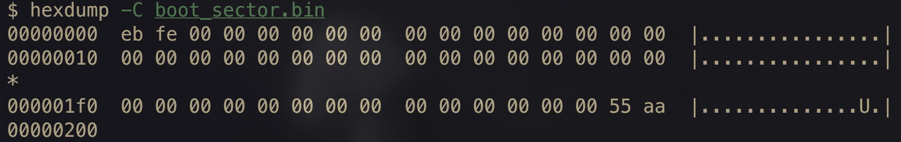
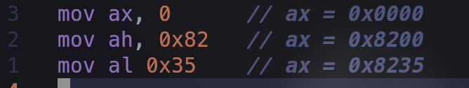
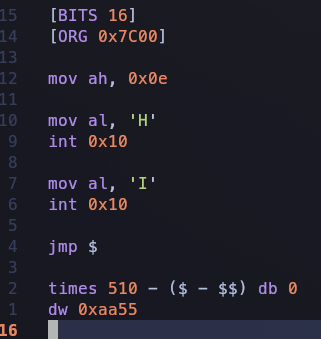

`WIP`

> [!NOTE]
> - **Educational Project**: This is a learning project and all the credit goes to the book `Writing a simple operating system` by `Nick Blundell`
>
> - **Purpose of this repo**: This repo will act as the notes of the stuff i'm learning along the way.

# A minimal x86 operating system built from scratch: boot sector, protected mode, and a C kernel

The book targets the x86 PC platform. It boots in 16-bit real mode (8086-compatible behavior, kept for backward compatibility), then transitions to 32-bit protected mode (introduced with the Intel 80386) to run a C kernel.

## Table of Contents
1. [Starting the system](#starting-the-system)
2. [Boot Sector ( What and a basic demonstration )](#boot-sector)
3. [Using Interrupts](#using-interrupts)


## Starting the system
At the very start before god created the universe, before any `operating system`, `kernel`, `bootloader`; we have the `BIOS`.

BIOS stands for `Basic Input/Output System`.
It's not stored on any hard drive, RAM, SSD etc etc, rather it's stored on a non-volatile flash memory which is soldered directly onto the motherboard.
> (As it's a non-volatile memory, its contents stay safe even when the system is turned off)

When the power button is pressed:
- Electricity flows into the machine, `Power Supply Unit (PSU)` wakes up and tries to maintain a steady state; and sends an `OK` signal once that is achieved.
- The CPU is held at a continuous `reset` state until the signal is received (so that random electric signals do not interfere with the CPU while the PSU is at it).

- Once the signal is received, The CPU begins executing at the reset vector (`0xFFFF0` in classic real-mode terms). This address is mapped to the BIOS flash chip and only has room for a few bytes, so it holds a jump to the actual BIOS startup code.

## Boot Sector
Now, the BIOS looks for the `Boot Sector`, <br>
The Boot sector is the place where the bootloader is stored.

In Legacy BIOS Booting (x86), Sector 0 (the boot sector which contains the bootloader), must end in a `magic number` which is `0xAA55`.

The BIOS reads raw sector 0 into the RAM at address `0x7C00` (also a pre-defined standard thingi in Legacy BIOS ) and looks at the 511-512 bytes for the magic number to identify the bootsector.


(I'll be using QEMU for the rest of this project)
(Modern PCs use UEFI, but QEMU defaults to a legacy BIOS- SeaBIOS which is why this all works)

#### Creating a simple boot sector:
we've created a file named `01-bootsector-demo.asm` which contains the assembly for this simple boot sector <br>
(This is just for the demonstration of how a boot sector would look) <br>

``` 
[BITS 16]
[ORG 0x7C00]

loop:
  jmp loop

times 510-($-$$) db 0
dw 0xaa55

```

This will create a simple bootsector that ends with the magic number and is exactly 512 bytes. <br>
In the above code <br>

`[BITS 16]`: Informs NASM assembler to generate 16-Bit x86 machine code.<br>

`[ORG 0x7C00]`: Important so that NASM loads the memory offsets correctly, as the BIOS loads the first sector into this address. essentially setting the origin (base address to `0x7C00`) in RAM.
> `jmp loop` is a relative jump and works either way (we do not need ORG for that). ORG starts mattering once we start referencing data like strings<br>

`loop: jmp loop`: creates an unconditional infinite loop. This is done so that the CPU remains active and WITHIN the boot sector (this is just for getting an idea of how the bootsector should look)

`times 510-($-$$) db 0`: `$` indicates where the assembler is right now and `$$` indicates the starting position. `db 0` (db = define byte) adds zeros. This line is essentially adding padding in the form of zeros uptill the 510th byte.

`dw 0xaa55`: Adds the 2-byte word with the hex value `0xaa55` at bytes 510 and 511 (dw = define word).

This file is saved with a `.asm` extention <br>

Assembling the file with <br>
`nasm -f bin 01-bootsector-demo.asm -o 01-bootsector-demo.bin` <br>

Generates the binary which we can hexdump to see how it turned out<br>
`hexdump -C 01-bootsector-demo.bin`



- We can see that the last 2 bytes make up the magic number, they're in reverse order (from `0xAA55`) because they're stored in little endian.

- `eb fe` is the machine code for `jmp` back to itself. `eb` = short jump, `fe` = -2 bytes.

You can try it out using
`qemu-system-i386 -drive format=raw,file= 01-bootsector-demo.bin`
, This pretends your `.bin` is a hard disk and boots from it. 

<br>

First we'll try to print something on the screen.<br>
We don't have any functions to do the same yet, so we'll have ask the `BIOS` to do the same ---- The question is how are we going to talk to the BIOS?<br>

## Using Interrupts 
There is a very neat thing at the basics of computer mechanism called `Interrupts`.
(<i> Interrupts are a mechanism that allow the CPU temporarily to halt what it is doing and run some other, higher-priority instructions before returning to the original task.</i> ~ an excerpt from the book)

The CPU has an **Interrupt Vector Table (IVT)** located at the very beginning of the RAM (`0x00`).
It is essentially an array of 256 pointers from `0x00` to `0xFF`, Each pointing to a memory address of a specific `ISR (Interrupt Service Routine)`

> Size of IVT:  each entry is 4 bytes (segment:offset), so the table is 1 KB, from 0x0000 to 0x03FF

Giving a unique interrupt number to every hardware function (*like displaying something on the screen or deleting something that's already there*) isn't possible because of the limited number of slots to store the pointers to ISRs (256 as mentioned above)

so, what is done is that: <br>
Instead of giving seperate interrupt number to every command, the designers grouped similar functions into a **single broad interrupt** 
For eg:
- `INT 0x10` handles all video/screen services. 
- `INT 0x13` handles all disk I/O services.

All this is good and all but how is this helpful?<br>
when we wanna store values for performing operations, we store them in registers.

x86 CPUs have 4 main general purpose registers, `ax`, `bx`, `cx`, and `dx`.
The neat thing is that they allow us to manupulate the high and low bits independently (` [15-8] and [7-0] bits `) such as:




Now with that knowledge, let's print "Hi" on the screen <br> 
I've created a file named `02-bootsector-hello.asm`


<br>
- Again, `[BITS 16]` and `[ORG 0x7C00]` mean the same as explained above in the first demo

- `mov, ah, 0x0E` sets the high bits of `ax` to `0x0E` which is the function code for teletype print.
- `mov al, 'H'` sets the lower bits of `ax` to the ASCII value of `H`, the stuff in the lower bits is what that's going to be printed
- `int 0x10` is for triggering the BIOS interupt, where this specific interupt (`0x10`) is the umbrella for all the video/screen related services.
> Setting `AH` to `0x0E` essentially selects the teletype printing routine within the BIOS video service handler invoked by `INT 0x10`.

- `jmp $` is used to jump back to the current position, i.e an infinite loop (`$` = current position of the assembler).

- `times 510 - ($ -$$) db 0` and `dw 0xaa55` is again, as explained above, used for adding padding of 0s and ending with the magic number

the output upon running `qemu-system-i386 -drive format=raw,file=02-bootsector-hello.bin` would be <br>


